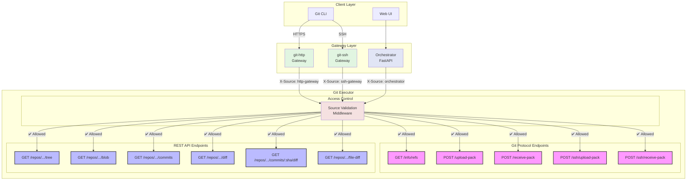

# CollabOps Git Executor

## 🚀 Current Status & Verification Results

**Last Updated:** July 24, 2025

### ✅ What's Working
- **Build & Compilation:** Full compilation working
- **Unit Tests:** All 8 packages passing (config, git, logging, permissions, protocol, repository, server, streaming)
- **Configuration Loading:** YAML config parsing and validation
- **Path Management & Security:** Full path validation, traversal attack prevention
- **Server Startup:** HTTP server starts successfully on localhost:9091 (config fixed!)
- **HTTP Endpoints:** Health check (`/health`) and API root (`/repos/`) responding
- **Repository Setup:** 3 repositories configured:
  - `📦 CollabOps/collabops-api-service (1.6M)`
  - `📦 bjm/collabops-api-orchestrator (1.2M)`  
  - `📦 testowner/testrepo (132K)`
- **Streaming Package:** Complete io.Pipe() implementation for memory-efficient Git operations
- **Protocol Compliance:** Enhanced error handling and Git Smart HTTP protocol compliance system
- **Task 9.1 ✅:** Git info/refs endpoint implementation
- **Task 9.2 ✅:** Git upload-pack endpoint implementation  
- **Task 9.3 ✅:** Streaming response mechanism implementation
- **Task 9.4 ✅:** Authentication and authorization for gateway requests
- **Task 9.5 ✅:** Error handling and Smart HTTP protocol compliance

### ⚠️ Known Issues & Missing Features
- **✅ FIXED:** Git Smart HTTP Endpoints now working with absolute paths
- **✅ FIXED:** Configuration updated to use absolute paths
- **Missing Diff API:** REST API endpoints for diff operations (needed by orchestrator) not yet implemented:
  - `GET /repos/:owner/:repo/diff?from=<ref>&to=<ref>` - Compare branches/commits
  - `GET /repos/:owner/:repo/commits/:sha/diff` - Get commit diff
  - `GET /repos/:owner/:repo/file-diff?path=<path>&from=<ref>&to=<ref>` - File-level diff
- **Missing Access Control:** Critical security middleware for endpoint access control not implemented:
  - No validation of `X-Source` header to identify calling component
  - No enforcement of endpoint access permissions per component
  - Gateways could potentially access REST endpoints (security risk)
  - Orchestrator could potentially access Git protocol endpoints (architectural violation)
- **Missing SSH Protocol Support:** SSH-specific endpoints not yet implemented:
  - `POST /ssh/upload-pack` - SSH fetch/clone operations from SSH gateway
  - `POST /ssh/receive-pack` - SSH push operations from SSH gateway

### 🧪 Testing Available
```bash
# Start the server (now working with fixed config!)
go run ./cmd/git-executor/main.go --config=config/test-config.yaml
# Server will start on localhost:9091

# Test server is working
curl http://localhost:9091/health
curl http://localhost:9091/

# Quick server verification
./scripts/test-server-status.sh

# Alternative: Use Makefile (now fixed!)
make test-manual-server

# Manual component testing
make test-manual-config        # Test configuration loading
make test-manual-paths         # Test path management & security
make test-manual-smart-http    # Test Git Smart HTTP (pre-made script)
./scripts/manual-test-git-protocol.sh  # Enhanced Smart HTTP testing
make test-manual-streaming     # Test streaming optimization
make setup-test-repos          # Set up additional test repositories

# Unit testing
go test ./internal/... -short  # All unit tests
```

### 🎯 Next Steps
- **✅ FIXED:** Configuration updated with absolute paths - Git Smart HTTP now functional
- **Task 10:** Implement Git Smart HTTP Protocol for Push (git-receive-pack)
- **Task 14 (NEW):** Implement Diff API endpoints for orchestrator integration
- **Task 15 (CRITICAL):** Implement Endpoint Access Control Middleware
- **Task 16 (NEW):** Implement SSH Protocol endpoints for SSH gateway

---

# CollabOps Git Executor

The `collabops-git-executor` is a backend component in the CollabOps platform responsible for executing actual Git operations. It serves as the **Git Logic Worker** in the CollabOps architecture, receiving requests from the `collabops-git-http` gateway and implementing the core Git Smart HTTP protocol logic.

> 📋 **Architecture Documentation:** See [docs/architecture/component-separation.md](docs/architecture/component-separation.md) for the complete architectural overview and component responsibilities.

## Architecture

```
Git Client (SSH/HTTP)
    ↓
Gateway Layer: collabops-git-ssh / collabops-git-http
    ↓ (REST / RPC)
collabops-git-executor  ← This repository (Git Logic Worker)
    ↓ (go-git)
Filesystem (e.g., /var/lib/git/repos/{user}/{repo}.git)
```

### Component Role

**collabops-git-executor** serves as the **Git Logic Worker** that:
- ✅ Implements Git Smart HTTP protocol (executor side)
- ✅ Handles all go-git operations and .git object processing
- ✅ Performs JWT decoding and permission verification
- ✅ Manages repository caching and streaming
- ✅ Processes packfiles and reference updates
- ❌ Does NOT directly accept Git client requests (gateway handles routing)

For complete architectural details and component separation, see the [Component Separation Documentation](docs/architecture/component-separation.md).

## Features

- **Git Operations**: Tree and blob queries, push/pull operations, commit log retrieval
- **Authentication**: JWT validation via header processing (X-USER-ID)
- **Permission Management**: Integration with API-Service for access control
- **Git Smart HTTP Protocol**: Full support for git fetch/push operations
- **Performance**: Repository caching and memory-efficient streaming
- **Observability**: Comprehensive metrics, logging, and health checks

## Quick Start

### Prerequisites

- Go 1.21+
- Docker (optional)

### Installation

```bash
git clone https://github.com/collabops/git-executor.git
cd git-executor
go mod download
```

### Configuration

Copy the sample configuration:

```bash
cp config/config.yaml.example config/config.yaml
```

Edit the configuration file to match your environment.

### Running

```bash
go run cmd/git-executor/main.go
```

### Docker

```bash
docker-compose up --build
```

## API Endpoints

### Repository Operations
- `GET /repos/:owner/:repo/tree?ref=:ref` - Get repository tree structure
- `GET /repos/:owner/:repo/blob?path=:path&ref=:ref` - Get blob content
- `GET /repos/:owner/:repo/commits?ref=:ref&limit=:limit&skip=:skip` - Get commit history

### Git Smart HTTP Protocol
- `GET /repos/:owner/:repo/info/refs?service=git-upload-pack` - Reference advertisement for fetch
- `POST /repos/:owner/:repo/git-upload-pack` - Git fetch packfile endpoint
- `GET /repos/:owner/:repo/info/refs?service=git-receive-pack` - Reference advertisement for push
- `POST /repos/:owner/:repo/git-receive-pack` - Git push packfile endpoint

### Health & Monitoring
- `GET /health` - Health check endpoint
- `GET /metrics` - Prometheus metrics

## Development

### Project Structure

```
├── cmd/                    # Application entry points
├── internal/               # Internal packages
│   ├── config/            # Configuration handling
│   ├── server/            # HTTP server implementation
│   ├── git/               # Git repository interface
│   ├── auth/              # Authentication middleware
│   ├── permissions/       # Permission verification
│   └── logging/           # Structured logging
├── pkg/                   # Reusable packages
├── config/                # Configuration files
├── docs/                  # Documentation
└── deployments/           # Docker and deployment configs
```

### Running Tests

```bash
go test ./...
```

### Building

```bash
go build -o bin/git-executor cmd/git-executor/main.go
```

## Configuration

The application uses YAML configuration with the following structure:

```yaml
server:
  port: 8080
  base_path: /repos

git:
  repo_root: /var/lib/git/repos
  enable_packfile: true

jwt:
  algorithm: RS256
  public_key_path: /etc/collabops/public.pem
```

## Contributing

1. Fork the repository
2. Create a feature branch (`git checkout -b feature/amazing-feature`)
3. Commit your changes (`git commit -m 'Add amazing feature'`)
4. Push to the branch (`git push origin feature/amazing-feature`)
5. Open a Pull Request

## License

This project is licensed under the MIT License - see the [LICENSE](LICENSE) file for details.

## 🔒 Endpoint Access Control Architecture

The git-executor implements strict endpoint access control to ensure each component can only access its authorized endpoints:



**Key Security Rules:**
- **HTTP/SSH Gateways** → Can ONLY access Git Protocol endpoints (pink)
- **Orchestrator** → Can ONLY access REST API endpoints (blue)
- **All requests** → Must include valid `X-Source` header
- **Unauthorized access** → Returns 403 Forbidden + security log

## Support

For support and questions, please open an issue in the GitHub repository. 