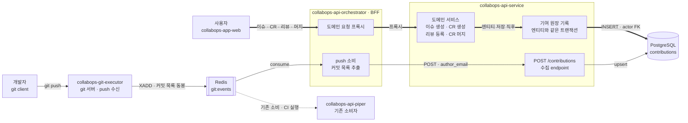
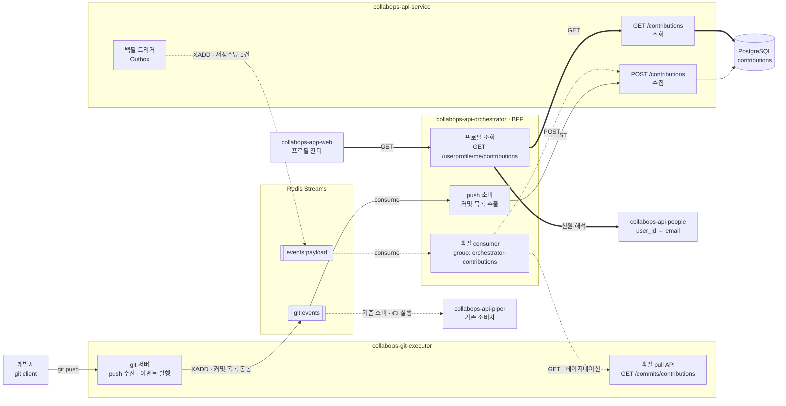
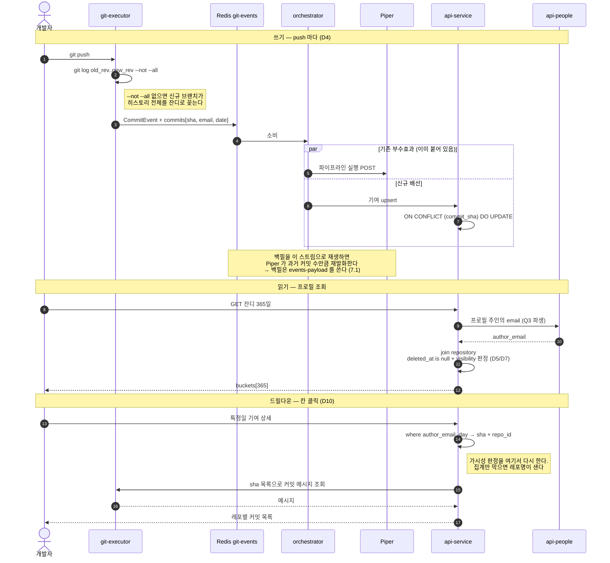
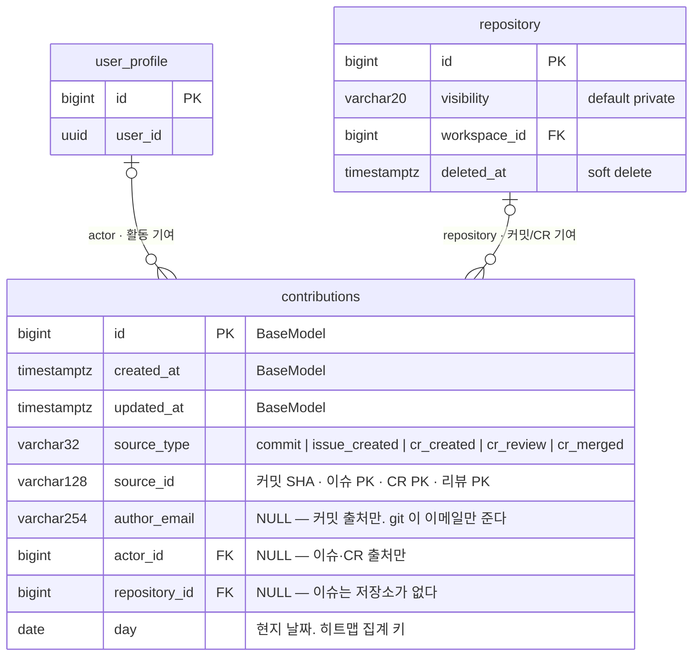

# 커밋 히스토리 액티비티 (contribution graph, "잔디") — 설계 초안

상태: **초안**. 조사 증적은 실제로 확인한 것만 파일:라인으로 적었고, 확인하지 않은
것은 §8 미해결로 뺐다. 구현 코드는 이 문서에서 만들지 않는다.

스코프: 사용자 프로필의 **연간 일별 기여 히트맵** (GitHub 잔디). 레포 단위
sparkline 은 이미 있으므로 (§2-A) 여기 대상이 아니다.

---

## 1. 목표 / 비목표

**목표**

- 사용자 1명의 최근 365일 **일별 커밋 수**를 워크스페이스 전체 레포에 걸쳐 집계
- private 레포 커밋이 권한 없는 뷰어에게 **레포를 특정할 수 있는 형태로 새지 않을 것**
- 프로필 페이지 응답이 레포 수에 비례해 느려지지 않을 것

**비목표 (이번 범위 밖)**

- 기여 정의 확장 (이슈/CR/리뷰 등) — 커밋만
- streak(연속 일수), 연도 전환 UI
- 한 사람이 이메일 여러 개를 쓰는 경우의 identity 병합 — **전제상 발생하지 않음**
  (§3 D6). 전제가 깨지면 §4 스키마의 `author_email` 키부터 재검토해야 한다.

---

## 2. 조사 증적

새 인프라를 제안하기 전에 "이미 있는 것으로 되는가"를 먼저 확인한 결과.

### A. 레포 단위 액티비티는 이미 있다 (재사용 대상 아님, 선례로만)

| 사실 | 증적 |
|---|---|
| `GET /repos/{owner}/{repo}/commits/activity` 존재. days 1~365, dense 버킷 | `internal/commits/handler.go:157`, `internal/commits/routes.go:51` |
| 구현은 `git log --since=N.days.ago --pretty=%aI` 단순 집계 | `internal/commits/native_git.go:405` |
| author 필터 **없음** — 레포 전체 집계다 | `internal/commits/schema.go:55` (`Ref`/`Days`/`GroupBy` 뿐) |
| `%aI` 를 RFC3339 로 파싱해 오프셋을 보존한 뒤, 버킷 키를 만들 때 **UTC 로 변환하며 버린다** | `internal/commits/native_git.go:441` (파싱), `internal/commits/handler.go:217` (`t.UTC().Format(...)`) |
| api-service 에도 레포 단위 30일 dense 배열이 이미 있다 | `collabops-api-service/apps/repositories/models.py:146` (`commit_activity` ArrayField) |
| 그 배열을 orchestrator 가 push 마다 PATCH 하고 있다 | `collabops-api-orchestrator/app/events/git/_helpers/repo_stats_sync.py` |

→ **만들려는 것의 레포 버전이 이미 돌고 있다.** 사용자 버전은 같은 패턴을 따른다.

### B. 이벤트 payload 로는 커밋 수를 셀 수 없다

| 사실 | 증적 |
|---|---|
| `CommitEvent` 는 커밋 **1개**(`CommitHash`)만 싣는다. 개수 필드 없음 | `internal/events/redis_stream.go:31` |
| 발행은 ref 업데이트 단위 — 커밋 10개 푸시해도 이벤트 1건 | `internal/protocol/receive_pack.go:609` |
| 다만 `OldRev` + `CommitHash` 가 둘 다 있어 **구간**은 알 수 있다 | `internal/protocol/receive_pack.go:613-614` |
| `UserID` 는 X-USER-ID 헤더 = **푸셔**. author 이메일은 payload 에 없다 | `internal/events/redis_stream.go:37`, `:53` |
| 발행 지점은 push 외에도 다수 (merge/revert/fork/commit API, ssh/tcp) | `internal/merge/handler.go:600`, `internal/revert/handler.go:155`, `internal/fork/handler.go:119`, `internal/commits/service.go:762`, `internal/protocol/ssh_protocol.go:713`, `internal/server/tcp_git_server.go:1017` |

### C. 컨슈머는 orchestrator, 그런데 DB 가 없다

| 사실 | 증적 |
|---|---|
| 스트림 `git:events`, 그룹 `orchestrator-git-events` | `collabops-api-orchestrator/app/shared/messaging/redis_streams.py:52` |
| 컨슈머 / push 핸들러 | `.../app/events/git/consumer.py:35`, `.../app/events/git/handler.py:286` |
| **orchestrator 에 ORM 이 없다** — 저장은 전부 api-service HTTP + Redis | (repo 전체에 SQLAlchemy/Django 세션 없음) |
| `repo_path` → 레포 레코드 해석은 resolver HTTP 경유 | `.../app/events/git/handler.py:963-1014` |

→ **"consume 영역에서 DB 업데이트" 는 구조상 불가능.** orchestrator 는 호출만 하고
테이블·쓰기는 api-service 에 둔다.

### D. visibility 는 도달 가능하지만 지금은 안 읽는다

| 사실 | 증적 |
|---|---|
| `Repository.visibility` CharField, `"private"` / `"public"`, **default private** | `collabops-api-service/apps/repositories/models.py:98`, `apps/repositories/enums.py:4` |
| `resolve_one(REPOSITORY)` 응답은 `{id, uuid, key, name}` — visibility 없음 | `.../app/events/git/handler.py:963-1014` |
| 컨슈머는 이미 `GET /repositories/{id}` 를 호출 중 (`default_branch` 만 꺼내 씀) | `.../app/events/git/handler.py:995` |
| `visibility` 에 **인덱스가 이미 있다** | `apps/repositories/models.py:199` |
| `is_public` 프로퍼티 존재 | `apps/repositories/models.py:212` |
| **`Repository` 는 soft delete** (`BaseModelWithSoftDelete`) — `deleted_at` 도 인덱스 있음 | `apps/repositories/models.py:63`, `:203` (`repo_del_idx`) |

→ visibility 는 **이미 오고 있는 응답에서 한 줄 더 읽으면 되는 값**이다. 새 API 불필요.

### E. 기존 사용자 단위 테이블 없음

| 사실 | 증적 |
|---|---|
| contribution / heatmap / streak 테이블 0개 | 두 레포 grep 0 hit |
| `UserProfile` 에는 `last_activity_at` 만, 일별 카운트 없음 | `collabops-api-service/apps/user_profile/models.py:58` |
| `apps/activity/models.py` 는 이슈/CR/goal/project 타임라인 — git 커밋 없음 | `collabops-api-service/apps/activity/models.py:39` |
| `apps/commits/models.py` 의 `Commit` 모델은 **죽어있다** (쓰기 경로 없음) | `collabops-api-service/apps/commits/models.py:8` |

### F. 백필 파이프라인이 이미 존재한다 — 그것도 같은 종류의 백필

| 사실 | 증적 |
|---|---|
| `repo.stats_backfill` — repo-list stats(`commit_activity` 포함) 일회성 백필 (Issue-5619) | `collabops-api-service/apps/repositories/migrations/0026_backfill_repo_stats.py` |
| 경로: data migration → Outbox insert(repo 당 1건, batch 500) → outbox worker → `events:payload` | 같은 파일 doc-string |
| 전용 컨슈머 + **전용 consumer group** | `collabops-api-orchestrator/app/main.py:877` (`RepoStatsBackfillConsumer`), `app/shared/messaging/redis_streams.py:36` (`orchestrator-repo-stats`) |
| 그 컨슈머가 push 경로와 **같은** `sync_repo_stats` 를 호출 | `.../app/events/git/_helpers/repo_stats_sync.py` |
| orchestrator 는 git-executor 를 호출할 수 있다 | `.../app/repositories/git_executor/commits.py` (`CommitsRepository.get_repos_commits_activity`), `.../repo_stats_sync.py:81` |

→ **`events:payload` 는 `git:events` 와 다른 스트림이고 consumer group 도 별개다.**
§7.1 에서 요구한 "Piper 를 안 건드리는 백필 채널" 이 이미 구현되어 있다.

### G. api-service ↔ git-executor 직접 호출은 구조적으로 금지

| 사실 | 증적 |
|---|---|
| "api-service 는 git-executor 를 호출하지 않으므로 ... 구조적으로 o2(BFF)만" | `collabops-api-service/apps/change_requests/application/services/UpdateChangeRequestConflictStatusService.py:7` |
| api-service 에 git 라이브러리 없음 (GitPython/pygit2/dulwich 전부 미의존), git subprocess 호출 0건 | `pyproject.toml`, `apps/` grep |
| api-service 의 `repo_path` 는 **계산된 문자열**일 뿐 — 파일시스템 접근 아님 | `apps/repositories/models.py:216` |
| git-executor 에 api-service 로 나가는 HTTP 클라이언트 없음 (언급은 전부 포팅 주석) | `internal/` grep, 호출 지점 0건 |

→ **양쪽에 동시에 닿는 것은 orchestrator 뿐이다.** 백필 주체는 orchestrator 로 강제된다.

---

## 3. 결정과 기각 사유

### D1. 읽기 시점 fan-out 이 아니라 쓰기 시점 집계

- **채택**: push 이벤트 소비 시점에 커밋을 영속화하고, 잔디는 그 테이블을 조회.
- **기각 — 읽기 시점 fan-out** (`/commits/activity?days=365&author=` 를 레포마다 호출):
  author 필터를 새로 뚫어야 하고(§2-A), 무엇보다 프로필 1회 렌더가 레포 수만큼의
  git 프로세스를 띄운다. 레포 수는 유저가 늘린다 — 우리가 통제하지 못하는 변수에
  응답시간이 비례하면 안 된다.

### D2. 카운터 증가가 아니라 커밋 sha 단위 row

- **채택**: `commit_sha` 를 PK 로 두고 `INSERT ... ON CONFLICT (commit_sha)
  DO UPDATE SET day = excluded.day`. 잔디는 `GROUP BY day`.
  (`DO NOTHING` 이 아니라 `DO UPDATE` 인 이유는 D8 말미 — 버킷 규칙 재적용 여지.)
- **기각 — UserProfile 에 카운터 컬럼 두고 `+1`**: 세 가지로 깨진다.
  1. 이벤트가 커밋당 1건이 아니다 (§2-B) → 10커밋 푸시가 +1
  2. Redis Stream 은 at-least-once. 재전달/컨슈머 재시작마다 카운터가 부풀고,
     한번 부풀면 **되돌릴 방법이 없다**
  3. 같은 커밋이 브랜치 두 개에 얹히면 이벤트가 두 번 온다
  - sha PK 는 1·2·3 을 전부 공짜로 막는다. 재계산·보정도 가능해진다.
- **기각 — 총합 1개만 저장**: 잔디는 날짜별 분포다. 총합으로는 그릴 수 없다.

### D3. author 기준, pusher 기준 아님

- **채택**: `author_email` 로 집계.
- **근거**: 남의 커밋을 대신 푸시하는 경우(cherry-pick, 패치 적용) 기여는 원저자
  것이다. GitHub 도 author 기준이다. `UserID`(푸셔)로 집계하면 대리 푸시가
  푸셔에게 잔디로 꽂힌다.
- **파생 문제**: 이메일 → 사용자 매핑이 필요하다. → D6 에서 해소.

### D4. 커밋 목록은 **발행 시점에 payload 로** 싣는다

- **채택**: git-executor 가 `old_rev..new_rev` 를 그 자리에서 풀어 payload 에 포함.
- **기각 — 컨슈머가 되묻기**: (a) `A..B` range 조회 API 가 없어서 새로 뚫어야 하고
  (`/commits/compare/summary` 는 개수만 준다 — `internal/commits/routes.go:65` —
  잔디엔 날짜·author 가 필요해 부족), (b) 왕복이 늘고, (c) 되묻는 사이 force-push 로
  커밋이 사라지는 레이스가 있다. 발행 시점 스냅샷은 이 레이스가 원천적으로 없다.

### D5. visibility 를 contributions row 에 복사하지 않는다

- **채택**: row 에는 `repo_id` 만. 가시성은 **조회 시점**에 레포와 조인해 판정.
- **기각 — denormalize (row 에 `is_public` 박기)**: 레포는 public↔private 로
  토글된다. 토글마다 그 레포 커밋 전부를 UPDATE 해야 하고, 한 건이라도 누락되면
  **private 커밋이 남의 프로필에 노출된다.** 되돌릴 수 없는 종류의 사고다.
- 조인 방식은 토글이 즉시 반영되고, 뷰어별 가시성도 같은 쿼리에서 갈린다.

### D6. author 식별자는 이메일 1개 — 전제로 고정

- **채택**: 사용자 1명 = 이메일 1개. `author_email` 을 그대로 identity 키로 쓴다.
- **근거**: 운영상 그렇게 쓰고 있다는 확인을 받았다. 별도 매핑 테이블도, 이메일
  목록 조회도 필요 없다.
- **기각 — 이메일 별칭 테이블 선제 도입**: 전제가 유지되는 한 순수 비용이다.
- **전제가 깨지는 신호**: 같은 사람의 잔디가 갈라진다는 제보. 그때 `contributions`
  는 건드리지 말고 **조회 시점에** 이메일 집합으로 `IN` 조회하도록 바꾸면 된다
  (row 는 이미 이메일별로 쪼개져 있으므로 마이그레이션 불필요). 이 확장성이
  `author_email` 을 키로 두는 이유이기도 하다.

### D7. **집계는 전량 노출, 상세는 ReBAC 으로 제한**

- **채택**: 잔디의 칸별 카운트는 뷰어와 무관하게 **그 사람의 전체 활동량**을 보여준다.
  칸을 눌러 들어가는 상세(어느 저장소, 어떤 커밋/CR)는 뷰어가 **접근 가능한 것만**
  보여준다. 판정은 `RepositorySelector.apply_visibility_filter()` 재사용
  (`apps/repositories/persistence/selectors.py:47`).
- GitHub 과 같은 모델이다. 다만 GitHub 은 소유자 토글로 private 포함 여부를
  정하게 하는데, 우리는 **항상 포함**한다 — 판정 주체가 소유자가 아니라 조직의
  접근 모델이기 때문이다(아래 기각안 참조).

- **왜 카운트는 가려도 되는가 (= 가리지 않는 이유)**: 카운트만으로 새는 것은
  "그 사람이 그날 얼마나 활동했나" 라는 **사람에 대한 메타데이터**이지, 보호 대상
  리소스의 내용이 아니다. 저장소 이름·존재·커밋 메시지·코드는 전부 상세 단계에서
  막힌다.
- **기각 — 접근 권한으로 카운트까지 거르기**: 유출은 0이 되지만
  **잔디가 뷰어의 권한에 따라 다르게 보인다.** B가 열심히 일했는데 A의 권한 때문에
  한산해 보이는 것은 사람에 대한 왜곡이고, 프로필이 인식·평가에 쓰이는 사내 도구에서
  그 해악이 유출보다 크다. 덤으로 집계가 뷰어별이 되어 캐시가 불가능해진다.
- **기각 — GitHub 식 소유자 토글**: 소유자가 opt-out 을 모르면 노출되고, 기본값을
  제외로 두면 위 왜곡 문제로 돌아간다. 우리는 권한 모델이 이미 있으므로 노출 범위를
  소유자 개인 설정에 맡길 이유가 없다.

- **반드시 지켜야 할 것 — 필터가 둘로 갈린다.**
  - 집계(`GET /contributions`): 저장소 필터 **없음**. 뷰어 무관 → 캐시 가능,
    조인 불필요.
  - 상세(드릴다운): ReBAC 필터 **필수**.
  후속 API 를 추가할 때마다 "이건 집계인가 상세인가" 를 판단해 엄격한 쪽을 적용해야
  한다. **한 곳만 빠뜨리면 저장소 이름이 샌다.** 접근 기반 전면 적용이었다면 규칙이
  하나여서 이 위험이 없었는데, 위 왜곡 문제와 맞바꾼 것이다.
- **숨긴 것을 숨기지 않는다.** 집계와 상세의 개수가 다를 때 그 차이를 UI 가 명시한다
  (예: "비공개 기여 N건 포함"). 그래야 뷰어가 "숨은 작업이 있다"를 추론하는 것이
  아니라 고지받는 것이 되어, 은밀한 추론 채널이 되지 않는다.

### D8. 하루 경계는 **커밋 자체의 타임존 오프셋** 기준

- **채택**: `%aI` 가 물고 오는 오프셋을 변환 없이 그대로 두고, 그 **날짜부**를 `day`
  에 넣는다. `2026-08-20T08:00:00+09:00` → `2026-08-20`.
  (`%aI` 가 실제로 `+09:00` 을 포함해 나오는 것은 이 레포에서 확인했다.)
- **의미**: "커밋한 사람에게 그때 며칠이었나". GitHub 와 같은 기준이다.

- **기각 — UTC 로 변환**: 우리 사용자 대부분이 KST(UTC+9)다. UTC 로 자르면
  **00:00\~09:00 KST 커밋이 전부 전날 칸으로 밀린다.** 오전에 커밋하는 사람은
  잔디가 통째로 하루씩 어긋난다. 하루의 3/8 구간이 오배치되는 것을 "일관성"으로
  정당화할 수 없다.
  - 참고: 레포 sparkline 은 지금 이 UTC 방식이다 (§2-A). **의도적으로 다르게
    간다** — 30일 개수 스파크라인은 경계 오차의 시각적 영향이 작고, 이미 배포된
    응답 계약이라 지금 바꾸면 외부 client 가 깨진다. 두 값이 하루 어긋날 수
    있다는 사실은 알고 있는 채로 둔다.
- **기각 — 조회 시 프로필 주인의 `UserProfile.timezone` 으로 변환**:
  1. `day date` 로는 불가능하고 `timestamptz` 를 저장해야 한다. 그러면 조회가
     `AT TIME ZONE` 을 타서 `(author_email, day)` 인덱스로 `GROUP BY` 를 못 한다.
  2. 사용자가 타임존 설정을 바꾸면 **과거 잔디 전체가 재배치**된다. 기여 기록이
     설정값에 따라 움직이는 건 기록으로서 이상하다.
  3. 그 필드가 실제로 신뢰할 만큼 채워지는지 **미확인**.
- **알려진 한계 (천장)**: 오프셋은 커밋한 **머신의 설정**이다. CI/임포트 커밋은
  `+00:00` 으로 찍히고, 여행 중 커밋은 현지 날짜가 된다. 그래도 전부 UTC 로
  강제하는 것보다 "그 사람의 그날" 에 가깝다. 바뀌어야 한다면 §7.1 백필 재실행으로
  소급 정정 가능하다 (아래).
- **재버킷 가능성 확보**: 이 결정이 나중에 뒤집혀도 스키마에 원본 timestamp 를
  보험으로 넣어둘 필요가 없다. **git 이 원본이고 백필이 멱등하므로**(D2), 규칙만
  바꿔 백필을 다시 돌리면 된다. 단 그러려면 upsert 가
  `ON CONFLICT (commit_sha) DO UPDATE SET day = excluded.day` 여야 한다 —
  `DO NOTHING` 이면 기존 행이 옛 규칙으로 남는다. `sha → day` 는 git 데이터의
  순수 함수라 재전송이 값을 훼손할 위험도 없다.

### D9. 커밋은 **default branch 도달 커밋만** 센다

- **채택**: default branch 에 들어온 커밋만 기여로 집계한다. GitHub 과 동일
  (GitHub 은 default branch + gh-pages 만 센다).
- **번복 이력**: 처음에는 all-ref 집계 + squash 중복 감수로 정했다(2026-08-21).
  활동 기여(CR 생성·리뷰·머지)를 추가하기로 하면서 뒤집었다 — 아래 근거 참조.

- **근거 — 활동 기여와 합치면 같은 작업이 2~3배로 부푼다.**
  커밋 5개짜리 CR 하나를 기준으로:

  | | GitHub | all-ref 집계 시 |
  |---|---|---|
  | feature 브랜치 커밋 | 0 | 5 |
  | squash 커밋 (default) | 1 | 1 |
  | CR 생성 | 1 | 1 |
  | CR 머지 | 1 | 1 |
  | **합계** | **3** | **8** |

  GitHub 이 브랜치 커밋을 세지 않는 것은 **PR 항목과 중복이기 때문**이다. 브랜치
  작업 기간의 잔디는 "PR 생성" 기여가 메운다 — 커밋과 PR 이 서로 보완하는 설계다.
  우리도 CR 기여를 넣기로 한 이상 같은 구조를 따르는 것이 일관된다.
  level 임계값이 절대 기준(1/3/6/10)이라, 부풀린 카운트는 곧 색 왜곡이 된다.

- **감수하는 것**: 머지 전에는 커밋 잔디가 뜨지 않는다. 그 공백은 **CR 생성 기여**가
  메운다 (GitHub 과 동일한 보완 구조). 활동 기여가 붙기 전까지는 이 공백이 그대로
  보이므로, 커밋만 있는 v1 기간에는 잔디가 머지 시점에 몰린다.
- **squash 워크플로와의 궁합**: 이 조직은 머지가 전부 squash 라 default branch 에는
  CR 하나당 커밋 하나가 남는다. squash 커밋의 author 는 머저가 아니라 **source
  브랜치 tip 커밋의 author** 로 보존되므로(`internal/merge/strategy_squash.go:41-47`,
  `internal/merge/pure_signature.go:46`) 원저자에게 정확히 귀속된다.
- **알려진 한계**: 브랜치에 여러 사람의 커밋이 섞여도 squash 후에는 tip 커밋 author
  1명에게 귀속된다. GitHub 의 squash 도 같은 성질이다.

- **부수 효과 — `--not --all` 이 불필요해진다.** 하나의 브랜치만 보므로 범위는
  `old_rev..new_rev` 로 충분하다. 저장소 최초 push 로 default branch 가 생기는
  경우에는 도달 가능한 커밋 전부가 맞다 — 그 전에 feature 브랜치로 들어온 커밋은
  (default 가 아니었으므로) 아직 집계되지 않았기 때문이다. §6 참조.

### D10. 드릴다운 — 특정일의 레포·커밋까지 내려간다

- **요구**: 잔디 칸을 누르면 그날 어느 레포에 무슨 커밋을 했는지 보여야 한다 (GitHub 동작).
- **스키마 변경 없음.** §4 테이블이 이미 `(commit_sha, repo_id, day)` 를 들고 있어
  `where author_email = $1 and day = $2` 한 줄이면 sha + repo 목록이 나온다.
  레포 이름과 레포별 개수는 `repository` 조인만으로 SQL 안에서 끝난다.
- **커밋 메시지는 저장하지 않는다.** 필요한 시점(칸 클릭)에 그 하루치 sha 로
  git-executor 에 조회한다. 저장하면 (a) amend/force-push 후 stale 해지고
  (b) git 과 진실이 두 벌이 된다. 하루치는 보통 수~수십 건이라 조회가 싸다.
- **드릴다운이 가시성을 책임진다** (D7). 집계에는 저장소 필터가 없으므로, 상세를
  주는 이 경로가 유일한 방어선이다. 뷰어가 접근 가능한 저장소만 목록에 넣고,
  나머지는 개수 차이로만 드러난다("비공개 기여 N건 포함").

### D12. 삭제된 항목의 기여는 **남긴다**

- **채택**: 이슈/CR/문서가 soft delete 되어도 그 생성 기여 행은 지우지 않는다.
- **근거**: 잔디는 "그 사람이 그날 일했다"는 기록이지 대상의 현재 존재 여부가
  아니다. 삭제까지 반영하려면 조회마다 원본 테이블 4개를 조인해 `deleted_at` 을
  확인해야 하는데, 그러면 "인덱스 하나로 끝나는 단일 쿼리"라는 D1 의 이점이
  사라진다.
- **감수하는 것**: 삭제된 이슈의 기여가 잔디에 남는다. GitHub 은 지운다.
- **저장소 삭제는 예외** — `repository` FK cascade 가 물리 삭제 시 걷어가고,
  조회는 §4 쿼리에서 `r.deleted_at is null` 로 이미 거른다. 저장소는 가시성
  판정 때문에 어차피 조인하므로 추가 비용이 없다.

---

## 4. 데이터 모델 (api-service)

```sql
create table contributions (
  commit_sha   varchar(64) primary key,       -- 멱등성 (D2)
  author_email text        not null,
  repo_id      bigint      not null references repository(id) on delete cascade,
                                        -- ⚠ Repository 는 soft delete 라 이 cascade 는
                                        -- 사실상 안 터진다. 아래 조회 조건을 볼 것.
  day          date        not null           -- author date 의 날짜부, 커밋 오프셋 기준 (D8)
);
create index on contributions (author_email, day);
create index on contributions (repo_id);
```

- `day` 는 **author date** 기준 (D3), 커밋 자체의 타임존 오프셋으로 자른다 (D8).
  변환이 없으므로 `(author_email, day)` 인덱스를 그대로 탄다.
- **삭제된 레포 처리 — cascade 에 기대면 안 된다.** `Repository` 는
  `BaseModelWithSoftDelete` 라 삭제해도 행이 남는다 (`apps/repositories/models.py:63`).
  FK cascade 는 hard delete 에만 반응하므로 **삭제한 레포의 기여가 잔디에 영원히
  남는다.** 조회에서 `r.deleted_at is null` 로 걸러야 한다 — GitHub 도 레포를
  지우면 잔디에서 사라진다. cascade 는 물리 삭제(정리 배치 등)에 대한 안전망으로만
  남겨둔다.
- 총합·streak 등 파생값은 저장하지 않는다. 전부 이 테이블에서 나온다.

조회:

```sql
-- $1 author_email, $2 since
-- $3 include_private : 본인 조회이거나(=항상 true) 주인이 토글 ON 이면 true (D7)
select c.day, count(*) as cnt
from contributions c
join repository r on r.id = c.repo_id
where c.author_email = $1
  and c.day >= $2
  and (r.id is null or r.deleted_at is null)   -- 삭제된 저장소만 제외
group by c.day;
-- 집계에는 뷰어 기반 필터가 없다 (D7). 저장소 제한은 드릴다운에서만 적용한다.
```

`visibility` 와 `deleted_at` 모두 인덱스가 이미 있어 (§2-D) 조인 비용은 추가 부담이
아니다. 그리고 `contributions` 는 `repository` 와 **같은 DB(api-service)** 에 있으므로
이 판정은 순수 SQL 조인이다 — resolver 도, HTTP 왕복도 개입하지 않는다.

집계는 **뷰어와 무관**하다 — 누가 보든 같은 숫자다. 그래서 캐시할 수 있고 조인도
가볍다. 저장소 제한은 드릴다운에만 걸린다 (D7):

| 보는 사람 | 토글 | `$3` | 레포명 노출 |
|---|---|---|---|
| 본인 | — | true | O |
| 타인 | OFF (기본) | false | O (public 뿐) |
| 타인 | ON | true | **X — 날짜·개수만** |

**집계와 드릴다운의 필터가 다르다.** 집계만 보고 "가시성 처리했다"고 넘어가면
드릴다운으로 저장소 이름이 샌다. 상세를 주는 API 는 예외 없이 ReBAC 필터를 건다.

FE 는 `[since, until]` 을 dense 하게 채워 7행 × 53열 그리드로 렌더한다
(레포 sparkline 이 이미 dense 배열 계약을 쓰고 있다 — `internal/commits/schema.go:72`).

---

## 5. 배선 — 3개 레포에 각각 무엇이 추가되는가

### 5.0 컴포넌트 — 통신 흐름

#### 그림 1. 정상 경로 — 기여가 쌓이는 두 갈래 (백필 제외)



**실선 = 커밋 경로, 굵은 선 = 활동 경로.** 둘이 같은 테이블에서 만난다.

이 비대칭이 설계의 핵심이다:

| | 커밋 | 활동 (이슈·CR·리뷰·머지) |
|---|---|---|
| 발생 위치 | api-service **밖** (git 저장소) | api-service **안** |
| 경유 | git-executor → Redis → orchestrator → HTTP | 없음 (같은 프로세스) |
| 전달 보장 | at-least-once → **멱등 장치 필요** | 같은 트랜잭션 → **애초에 중복이 없다** |
| 신원 | `author_email` (git 이 이메일만 준다) | `actor` FK (UserProfile 을 이미 안다) |
| 하루 경계 | 커밋 자체 오프셋 (D8) | 서버 `created_at` (UTC) |

활동 기여에 스트림을 태우지 않는 이유가 여기 있다. 이미 그 트랜잭션 안에 있는데
이벤트로 내보냈다가 되받으면, 없던 중복·순서·유실 문제를 스스로 만드는 셈이다.
`(source_type, source_id)` unique 는 커밋 경로 때문에 필요한 것이고, 활동 경로에는
공짜로 따라오는 안전망이다.

반대로 커밋을 in-process 로 만들 수는 없다 — git 이 다른 서비스에 있다.

#### 그림 2. 커밋 경로 상세 — 백필과 읽기 포함



**선 종류가 곧 경로다** — 실선은 라이브 쓰기, 점선은 백필, 굵은 선은 읽기.

이 그림이 말하는 것 셋:

1. **스트림이 갈라진다.** 라이브는 `git:events`, 백필은 `events:payload`.
   `git:events` 에는 Piper 가 이미 붙어 있어서(점선), 백필을 그쪽으로 흘리면 과거
   커밋 수만큼 CI 가 실제로 돈다. 채널 분리가 그 사고를 구조적으로 막는다.
2. **수집구는 하나다.** 라이브와 백필이 같은 `POST /contributions` 로 수렴한다.
   멱등이라 두 경로가 겹쳐 돌아도 안전하다.
3. **읽기는 git 을 타지 않는다.** 잔디 본체는 orchestrator → api-service → Postgres
   로 끝난다. git-executor 가 읽기 경로에 없다는 것이 D1(저장소 수에 무관)의 실체다.
   대신 신원 해석 홉이 하나 있다 — 커밋 기여는 `author_email` 로 저장되는데 FE 는
   `user_id` 만 알고, 그 변환은 api-people 만 할 수 있다.

### 5.1 시퀀스 — push 에서 잔디까지



읽기 경로에 git-executor 가 **드릴다운에서만** 등장한다는 점이 핵심이다. 잔디 본체
(365칸)는 git 을 아예 타지 않고 SQL 로 끝나므로 레포 수와 무관하다 (D1).

### 5.2 git-executor

push 이벤트 payload 에 커밋 목록 추가:

```
git log --pretty=%H%x09%aE%x09%aI  old_rev..new_rev
```

→ `commits: [{sha, author_email, authored_at}]`

- 발행 지점은 `receive_pack.go` / `ssh_protocol.go` / `tcp_git_server.go` 로 여러
  곳이다 (§2-B). **커밋 범위를 푸는 함수는 한 군데에 두고 모든 발행 지점이 그걸
  쓰게 한다** — 지점마다 복사하면 한 곳만 고쳐지는 버그가 난다.
- merge/revert/fork/commit-API 발행 지점은 커밋이 1개거나 이미 알려져 있어
  같은 구조체를 그대로 채우면 된다.

### 5.3 api-service

- §4 테이블 + 마이그레이션
- upsert 엔드포인트 (커밋 배열 받아 `ON CONFLICT DO NOTHING`)
- 프로필 잔디 조회 엔드포인트 (§4 쿼리 + 뷰어 권한)

### 5.4 orchestrator

- **라이브**: `_handle_push_event` → `_schedule_push_side_effects` 에 sync 하나 추가.
  `_helpers/repo_stats_sync.py` 와 같은 모양 (§2-A).
- **백필**: 새 consumer + handler (`app/events/contributions_backfill/`).
  `app/events/repo_stats_backfill/` 를 복제하고 `app/main.py` 의 시작 목록
  (`:1092` 인근)에 등록.
- visibility 는 두 경로 모두 **읽지 않는다** (D5). repo_id 만 넘긴다.

---

### 5.5 FE 계약 — 이미 만들어져 있다 (실측)

`collabops-app-web` 의 프로필 잔디는 **완성되어 있고 placeholder 로만 그린다.**
컴포넌트 주석이 계약을 직접 명시한다:

> 현재는 UI 자리표시 데이터로 그린다. 일별 집계 엔드포인트가 없어서인데 (…)
> 연결 시 `placeholderContributions` 자리에 집계 응답(`{ "yyyy-MM-dd": count }`)만 넣으면 된다.

| 확인 | 증적 |
|---|---|
| 잔디 컴포넌트 (툴팁·범례·월라벨까지 완성) | `src/views/profile-page/ui/profile-contribution-graph.tsx` |
| 격자 빌더 · 입력 타입 | `src/views/profile-page/lib/contribution-grid.ts` |
| 입력은 **sparse map** — `counts[date] ?? 0` 로 없는 날을 0 처리 | `contribution-grid.ts` `buildYearContributionGrid` |
| level 0~4 는 **FE 가 계산** (절대 기준 1/3/6/10) | `contribution-grid.ts` `toContributionLevel` |
| `total` 도 FE 가 합산 | 같은 함수 |
| **연도 고정** — rolling 365 가 아니라 1월~12월 | `buildYearContributionGrid(year)` |
| 주 시작 **월요일**, 앞뒤로 전년/다음해 며칠이 붙어 52~53주 | `WEEK_STARTS_ON = 1` |
| 라우트는 **본인 프로필** | `ROUTES.PROFILE.ME(slug)`, `app/(app)/[slug]/profile/page.tsx` |
| 사용자 식별자는 **user_id(UUID)**, email 아님 | `useUserprofileMeListQueryV2()` → `me.user_id` |
| 워크스페이스 slug 가 URL 에 있다 | 같은 라우트의 `[slug]` |
| 쿼리 훅은 **OpenAPI codegen 산출물** | `@/entities/userprofile` 의 `useUserprofile*QueryV2` |

#### 이 확인이 설계를 바꾸는 지점

1. **응답은 dense 가 아니라 sparse 여야 한다.** §4 의 "dense 365 buckets" 는
   레포 sparkline 계약을 그대로 가져온 것이었는데, FE 는 없는 날짜를 스스로 0 으로
   채운다. 커밋 있는 날만 보내면 되고 응답이 훨씬 작아진다.
2. **`days=365` 가 아니라 `from`/`to`.** 격자가 연도 고정이라 실제 필요 범위는
   "1/1 이 속한 주의 월요일 ~ 12/31 이 속한 주의 일요일" 이다. FE 가 이미 그 두
   날짜를 계산하므로 그대로 받는 게 가장 단순하고, 주간 섹션·드릴다운에도 재사용된다.
3. **level / total 을 서버가 주면 안 된다.** FE 가 소유한 규칙이고, 서버가 같이
   내려주면 두 벌이 되어 어긋난다.
4. **FE 라우트는 현재 본인 프로필뿐**이다 (`ROUTES.PROFILE` 에 `ME` 하나). 하지만
   **API 는 처음부터 `{user_id}` 를 받는 일반형으로 만든다** — `/me` 전용으로 만들면
   타인 조회를 붙일 때 BFF 계약과 생성된 FE 훅을 갈아야 한다. 가시성은 D7 의 접근
   권한 필터가 본인/타인을 한 경로에서 처리한다.
5. **Q6 답이 사실상 나와 있다.** 워크스페이스 slug 가 URL 에 있으므로
   워크스페이스 스코프가 자연스럽다.
6. **드릴다운 UI 는 아직 없다.** 툴팁이 count 만 보여준다
   (`"9월 24일에 7건의 활동"`). D10 은 FE 작업이 별도로 필요하다.

#### 엔드포인트 (제안)

```
GET /api/v2/userprofile/{user_id}/contributions?from=2025-12-29&to=2027-01-03
→ { "counts": { "2026-01-05": 3, "2026-01-07": 1, ... } }
```

- `user_id` → email 해석은 서버가 api-people 로 (§8-Q3 파생).
- 빈 날짜는 키 자체를 생략한다.
- 워크스페이스 스코프면 `?workspace=` 추가 (Q6 확정 후).

---

## 6. 엣지 케이스

| 케이스 | 처리 |
|---|---|
| **default 가 아닌 ref push** | 집계하지 않는다 (D9). 이벤트 payload 에 커밋을 싣지 않는다 |
| **default branch 최초 생성** | 도달 가능한 커밋 전부가 새 기여다 — 그 전 feature 브랜치 커밋은 집계된 적이 없다. `--not --all` **불필요** |
| **force-push (default branch)** | `old_rev..new_rev` 가 비거나 줄어든다. 사라진 커밋의 기여 행은 남는다(D12 와 같은 원리 — 그날 일한 사실은 유효) |
| **같은 커밋이 여러 브랜치** | sha PK 가 흡수 (D2) |
| **이벤트 재전달** | sha PK 가 흡수 (D2) |
| **거대 푸시** (커밋 수천 개) | payload 팽창. 상한을 두고 초과 시 range 만 싣고 컨슈머가 되묻기 — **단, 실제로 문제가 관측된 뒤에 붙인다** |
| **레포 public↔private 토글** | 조회 시 조인이라 자동 반영 (D5) |
| **레포 삭제** | cascade |
| **커밋 되돌림/rebase 로 사라진 커밋** | 현재 설계는 남긴다. GitHub 도 남긴다 (푸시된 시점에 한 기여는 기여). |

---

## 7. 구현 순서

각 단계는 독립적으로 머지 가능해야 한다.

1. **api-service** — 테이블 + upsert 엔드포인트. 아직 아무도 안 부른다.
2. **git-executor** — payload 에 `commits[]` 추가. 컨슈머는 아직 무시한다.
   (필드 추가라 하위호환)
3. **orchestrator** — upsert 호출 배선. 이 시점부터 데이터가 쌓인다.
4. **api-service** — 잔디 조회 엔드포인트 + 권한.
5. **FE** — 히트맵 렌더.
6. **백필** — §7.1. 1 단계(테이블+upsert)와 git-executor pull API 만 있으면 돌릴 수
   있고, 3 단계(라이브 배선)와 순서를 다투지 않는다. 겹쳐 돌아도 sha PK 가
   흡수한다 (D2).

### 7.1 백필

**가능하다.** 그리고 별도 설계가 거의 필요 없다 — D2 의 sha PK 덕분에 백필은
"같은 upsert 를 과거 커밋에 대해 한 번 더 부르는 것" 이상이 아니다.

```
git log --all --pretty=%H%x09%aE%x09%aI      # 레포 1개 전체 히스토리
```

- **멱등** — 중단 후 재실행, 라이브 배선과 동시 실행, 두 번 돌리기 전부 안전.
  진행률 추적이나 체크포인트 테이블이 필요 없다.
- **비용 실측** (2026-08-21, 로컬):
  `git-executor` 1,161 커밋 → **0.03초 / 103 KB**. 커밋당 ~88 byte, ~36,000 커밋/초.
  사내 최대급인 `app-web` 이 12,376 커밋이므로 레포 1개가 **1초 미만**이다.
  레포 100개 × 평균 1만 커밋 = 100만 행이어도 git 작업 총합이 30초 수준,
  테이블은 인덱스 포함 수백 MB 이내. **백필 비용은 제약이 아니다.**
- **비용은 O(전체 커밋 수), 1회** — `--pretty` 만 쓰고 tree/blob 을 건드리지 않는다
  (`internal/commits/native_git.go:405` 의 액티비티 집계와 동일한 접근 방식). diff 를
  뜨지 않으므로 레포 크기가 아니라 커밋 **개수**에만 비례한다.
- **`--all` 인 이유**: 기본 브랜치만 훑으면 머지되지 않은 브랜치의 기여가 통째로
  빠진다. 반대로 `--all` 은 도달 불가능해진 커밋(reflog 전용)은 포함하지 않는다 —
  의도한 동작이다.
- 레포 단위로 쪼개 돌리고 실패한 레포만 재시도한다. 전체를 트랜잭션으로 묶지 않는다.

#### 백필을 `git:events` 스트림으로 흘리지 말 것 ⚠️

가장 그럴듯해 보이는 안 — "과거 push 이벤트를 재생하면 기존 컨슈머가 알아서
처리한다" — 은 **위험하다.**

orchestrator 의 push 핸들러는 기여 집계만 하는 게 아니다:

| 부수효과 | 증적 |
|---|---|
| **Piper 파이프라인 실행 POST (CI 트리거)** | `collabops-api-orchestrator/app/events/git/handler.py:287`, `:339` (`_post_piper_run`) |
| 신규 브랜치 배너 발행 | `.../handler.py:420` |
| CR source/target SHA 동기화 | `.../handler.py:337` |
| repo 통계 / language stats PATCH | `.../handler.py:315`, `:483` |
| push timestamp Redis 기록 | `.../handler.py:472` |

히스토리를 스트림으로 재생하면 **과거 커밋 수만큼 CI 런이 실제로 트리거되고**
알림이 나간다. 되돌릴 수 없는 종류의 사고다.

→ 백필은 **api-service 의 upsert 엔드포인트를 직접** 호출한다. orchestrator 를
경유하지 않는다. 이것이 §5.2 의 upsert 를 orchestrator 전용 내부 API 가 아니라
독립 엔드포인트로 두는 이유다.

#### 실행 주체 — `repo.stats_backfill` 파이프라인을 그대로 복제한다

백필은 (a) 레포 접근과 (b) api-service 쓰기가 동시에 필요한데, **양쪽에 닿는 것은
orchestrator 뿐이다** (§2-G). 그리고 그 배선은 이미 있다 (§2-F):

```
api-service data migration
  → Outbox insert (repo 당 1건, batch 500)
  → outbox worker → events:payload 스트림
  → orchestrator 전용 consumer (group: orchestrator-contributions)
  → git-executor 에서 커밋 목록 pull
  → api-service upsert (§5.2 와 동일 엔드포인트)
```

- **`git:events` 가 아니라 `events:payload`** 를 쓴다 → Piper 트리거·CR 동기화·알림
  경로를 구조적으로 안 탄다. 앞 절의 요구사항이 채널 선택만으로 충족된다.
- **consumer group 을 새로 판다** (`orchestrator-contributions`). 기존
  `orchestrator-repo-stats` 에 얹으면 두 백필의 실패·lag 가 엮인다. 멱등 키도
  group 별로 독립이다 (`redis_streams.py:48`).
- migration 작성 규칙은 `0026_backfill_repo_stats.py` 를 그대로 따른다:
  historical model(`apps.get_model`)만 사용, `atomic = False`, **fail-soft**
  (어떤 실패도 migrate/배포를 막지 않는다), 재실행 방지는 `django_migrations` 가 담당.

#### 다만 git-executor 에 pull API 가 하나 필요하다

라이브 경로(D4)는 커밋을 **push** 로 밀어넣지만, 백필은 orchestrator 가 **pull**
해야 한다. 그런데 기존 `/commits` 는 ref 기준 페이지네이션이라 `--all` 전량 조회가
안 되고, `/commits/activity` 는 개수만 준다 (author 없음, §2-A).

→ `(sha, author_email, authored_at)` 삼중항을 전 ref 에 대해 페이지네이션으로
내려주는 엔드포인트 하나. **이번 설계에서 진짜로 새로 만드는 유일한 git API 다.**
응답 shape 은 D4 의 이벤트 payload 와 동일하게 맞춰, 컨슈머가 라이브/백필 두 경로에서
같은 파싱·같은 upsert 를 쓰게 한다.

---

## 8. 미해결 질문

- **Q1. ~~날짜 경계 타임존~~** — 해소. D8 (커밋 자체 오프셋 기준).
- **Q3. ~~매칭 안 되는 author~~** — 해소. **전부 저장한다.**
  api-service 에는 사용자 email 을 보관하는 모델이 아예 없다 (프로필 필드는
  api-people 소유 — `apps/user_profile/models.py:14` 주석). 따라서 쓰기 시점에
  매칭하려면 write path 가 api-people 에 의존하게 되는데, 그럴 이유가 없다.
  전부 저장하면 ① write path 가 api-people 과 결합되지 않고 ② 나중에 그 이메일이
  등록돼도 소급이 공짜다. 비용은 커밋당 88 byte 라 무시 가능(§7.1 실측).
  - **파생**: 조회 시 "프로필 주인의 email" 은 api-people 에서 가져와야 한다.
    잔디 조회는 **api-people 1회 + SQL 1회** 다 (레포 수와 무관한 점은 그대로).
- **Q5. ~~백필 범위~~** — 해소. **전체 히스토리.** §7.1 실측에서 레포 1개가 1초
  미만, 100만 커밋이어도 총 30초 수준으로 나왔다. 자를 이유가 없고, 자르면
  "총 기여 수" 지표를 영영 못 낸다.
- **Q7. ~~백필 실행 주체~~** — 해소. §2-F/§2-G, §7.1 참조 (orchestrator 로 강제,
  `repo.stats_backfill` 파이프라인 복제).
- **Q8. 백필 중 라이브 푸시와의 경합** — 부분 해소. git-executor 에 동시성 제어가
  이미 있다 (`internal/connection/concurrency_control.go:18` —
  `maxConcurrentClones` / `maxConcurrentPushes`). 다만 백필의 `git log` 는
  clone/push 가 아니라 **이 제어를 타지 않는다.** 백필 전용 상한이 필요한지는
  여전히 측정 대상. (실측상 레포당 1초 미만이라 순차 실행이면 문제없을 가능성이 높다.)
- **Q9. 웹/API 로 만든 커밋의 타임존 (D8 의 실제 구멍).** git-executor 의 커밋 생성
  경로는 author date 를 **UTC 로 고정**한다 —
  `internal/commits/service.go:504` (`now := time.Now().UTC()`), `:510` (`When: now`).
  실제로 이 레포 히스토리에도 같은 사람의 커밋이 `+09:00` 과 `+00:00` 로 섞여 있다.
  → KST 사용자가 웹에서 08:00 에 커밋하면 `T23:00+00:00` 이 되어 D8 기준으로도
  **전날 칸**에 들어간다. D8 이 막으려던 바로 그 오배치가 웹 경로로 되돌아온다.
  **처리 가능하고 매우 싸다**: 요청 구조체에 `Date` 필드가 **이미 있다**
  (`internal/commits/schema.go:191` — `CommitAuthor.Date time.Time`). 계약은 이미
  갖춰져 있는데 서비스가 그 값을 **무시하고** `time.Now().UTC()` 로 덮어쓰는 것뿐이다.
  → "무시하지 않기" + zero-value 폴백만 넣으면 된다. FE 가 오프셋 포함
  RFC3339 를 보내면 그대로 반영된다. 남은 결정은 FE 가 보낼지 여부.
- **Q11. 저장소 없는 기여의 드릴다운 가시성.** 이슈 생성 기여는 `repository` 가
  비어 있어 D7 의 저장소 필터가 걸리지 않는다. **집계는 어차피 전량이라 무관하지만,
  드릴다운에서 이슈 제목이 그대로 노출된다.** 이슈는 프로젝트에 속하고
  `Project.is_public` 이 있으므로(`apps/projects/models.py:129`) 프로젝트 단위의
  같은 필터가 필요하다. 이슈 기여를 붙일 때 반드시 같이 정한다.
- **Q6. 워크스페이스 경계** — 데이터는 확인됨, **결정만 남았다.**
  `workspace_members` 테이블이 있어 (`apps/workspaces/models.py:147`) 한 사용자가
  여러 워크스페이스에 속할 수 있고, `Repository` 는 `Workspace` FK 를 가진다.
  따라서 워크스페이스 단위로 자르는 것도 전역 합산도 §4 쿼리에 조건 한 줄 차이다.
  제품 결정 사항.
- **Q10. ~~default branch 만 셀 것인가~~** — 해소. **모든 ref, squash 중복 감수**
  (D9, 2026-08-21 제품 결정).

---

## 12. 배포 고려사항 — 백필 전략

### 12.1 백필은 두 종류다 (경로가 다르다)

원장을 일반화하면서(§D11) 채워야 할 과거 데이터가 두 갈래가 됐다.

| | 커밋 기여 | 활동 기여 (이슈/CR/리뷰/머지) |
|---|---|---|
| 원본 | git 저장소 | api-service 테이블 (`issue_activity_events`, `change_request_activity_events`, `review`, `change_request`) |
| 경로 | Outbox → `events:payload` → orchestrator → git-executor pull → 수집 API | **api-service 내부 SQL** (`INSERT ... SELECT`) |
| 서비스 경유 | 3개 | 1개 |
| 신원 | `author_email` | `actor` FK |

**활동 백필이 훨씬 싸다.** 데이터가 이미 같은 DB 에 있으므로 스트림도, HTTP 왕복도,
orchestrator 도 필요 없다. data migration 한 개에서 `INSERT ... SELECT ... ON CONFLICT
DO NOTHING` 으로 끝난다. 커밋 백필만 서비스 3개를 거친다 — git 이 api-service 밖에
있기 때문이다.

이 비대칭을 억지로 통일하지 않는다. "모든 백필은 이벤트로" 같은 대칭은 활동
백필에 불필요한 3-hop 을 씌울 뿐이다.

### 12.2 배포 순서

```
1) api-service   원장 테이블 + 수집 endpoint      (아무도 호출하지 않음)
2) orchestrator  라이브 배선 + 백필 consumer      (commits[] 가 없어 no-op)
3) git-executor  payload commits[] + pull API     (여기서부터 라이브 데이터가 흐른다)
4) 백필 트리거    활동 백필 migration + 커밋 백필 Outbox 발행
```

각 단계가 **혼자 배포돼도 깨지지 않는지**가 순서의 근거다.

- **1 단독** — 빈 테이블과 호출자 없는 endpoint. 무해.
- **2 단독** — `event.commits` 가 빈 목록이라 수집 예약이 early return 한다. 호출 0건.
  consumer 는 뜨지만 발행된 이벤트가 없다.
- **3 이 마지막인 이유** — git-executor 는 **생산자**다. 소비 체인이 완성되기 전에
  켜면 그 사이 push 커밋들이 `commits[]` 를 싣고 나가지만 아무도 받지 않는다.
  백필이 나중에 메우긴 하지만, 안 만들 구멍이다.
- **4 가 2 보다 뒤여야 하는 이유 (중요)** — Redis consumer group 은 첫 기동 때
  생성된다. 그 전에 발행된 이벤트는 group 이 `$`(신규만)로 만들어지면 **통째로
  유실된다.** 트리거를 돌리기 전에 `orchestrator-contributions` group 이 실제로
  존재하는지 확인해야 한다.

역순 배포(3 → 1)는 금지가 아니라 손해다. orchestrator 가 없는 상태의 커밋은
백필로 다시 주워야 한다.

### 12.3 멱등성 — 재실행이 전략의 핵심

`(source_type, source_id)` unique + `ON CONFLICT DO UPDATE` 라 백필은 **몇 번
돌려도 같은 결과**다. 이 성질이 운영 부담을 통째로 없앤다:

- 중단 후 재실행 안전 → 체크포인트 테이블·진행률 추적 불필요
- 라이브 push 와 동시 실행 안전 → 서비스 정지 불필요
- 부분 실패 시 **전체 재실행**이 정답 → 어디까지 됐는지 추적할 필요 없음
- 날짜 산정 규칙(§D8)이 바뀌어도 재실행만으로 소급 정정 (`DO NOTHING` 이 아니라
  `DO UPDATE` 인 이유)

### 12.4 비용 — 실측

`git log --all --pretty` 는 tree/blob 을 건드리지 않아 커밋 **개수**에만 비례한다.

| 대상 | 커밋 | 시간 |
|---|---|---|
| git-executor | 1,161 | 0.03 초 |
| app-web (사내 최대급) | 12,376 | 1 초 미만 |
| 주력 6개 레포 합계 | 32,087 | 1 초 남짓 |

행 크기는 인덱스 포함 **약 300 byte** — 32k 커밋 ≈ 10 MB, 연간 증가 ≈ 13 MB.
활동 백필은 같은 DB 안 `INSERT ... SELECT` 라 더 싸다.

**백필 비용은 제약이 아니다.** 따라서 범위를 자르지 않는다(전체 히스토리).

### 12.5 실패 모드

| 상황 | 동작 | 근거 |
|---|---|---|
| 저장소 resolve 실패 | 로그 남기고 **ack** | 재시도로 낫지 않는다. raise 하면 DLQ 만 쌓인다 |
| git-executor 조회 실패 | 그 페이지에서 **중단** | 건너뛰면 구멍이 생긴다. 멱등하므로 재시도가 처음부터 다시 훑어도 손해 없음 |
| 수집 API 실패 | 삼킴 (그 배치만 유실) | 기여 집계는 push 의 부수 기능. raise 하면 같은 경로의 CI 트리거·CR 동기화까지 죽는다 |
| 페이지 200 초과 | 로그 남기고 중단 | 무한 루프로 api-service 를 때리는 사고 방지 (2만 커밋 상한) |

유실된 배치는 **트리거 재발행**으로 복구한다. 이것이 재시도 로직을 정교하게
만들지 않은 이유다 — 멱등성이 있으면 "전부 다시" 가 가장 단순하고 확실한 복구다.

### 12.6 실행 절차

#### A. 사전 조건 — 순서를 어기면 유실된다

1. **api-service 배포** — 원장 테이블 + `POST /contributions`. 호출자가 없어 무해.
2. **orchestrator 배포** — 백필 consumer 기동. 이때 consumer group 이 **생성된다**.
3. **git-executor 배포** — `GET /commits/contributions` (pull API) + 라이브 payload.
4. **consumer group 존재 확인** — 이게 4번인 이유는, group 이 없는 상태에서 5~6번을
   돌리면 발행된 이벤트가 `$`(신규만) 로 만들어질 group 을 만나지 못해 **통째로
   사라지기** 때문이다. 실패해도 에러가 안 나고 조용히 없어진다.
   ```
   redis-cli XINFO GROUPS events:payload | grep orchestrator-contributions
   ```

#### B. 운영자가 실행하는 것

5. **활동 기여 백필** — api-service data migration 적용 시 1회 자동 실행.
   같은 DB 안 `INSERT ... SELECT` 라 외부 호출이 없다. `django_migrations` 가
   재실행을 막는다.
6. **커밋 기여 백필 — 소량 검증**. 저장소 1~2개로 먼저 돌려 12.6.D 를 확인한다.
7. **커밋 기여 백필 — 전체**. 저장소마다 Outbox 이벤트 1건이 발행된다.

#### C. 시스템이 자동으로 하는 것 (6~7 이후)

8. outbox worker 가 Outbox 행을 `events:payload` 로 relay (`XADD`).
9. 백필 consumer 가 소비. 대상 event_type 이 아니면 ack-skip.
10. `repo_path` → resolver → **repository_id(int PK)** 해석. 해석 실패면 로그 남기고
    ack (재시도로 낫지 않는 상태라 DLQ 에 넣지 않는다).
11. git-executor 에서 커밋을 **1000건씩** 조회 (`--all`, offset 페이지네이션).
12. 페이지마다 `POST /contributions` 로 수집. `has_more` 가 false 이거나 200페이지
    상한에 닿으면 종료.
13. api-service 가 `(source_type, source_id)` 충돌 시 갱신하며 upsert.

11~12 는 저장소당 페이지 수만큼 반복된다. 8~10, 13 은 페이지/저장소 단위 1회.

#### D. 검증

14. `contributions` 행 수가 대상 커밋 수와 자릿수가 맞는가.
15. 특정 사용자 잔디가 그 사람 `git log --author` 결과와 일치하는가.
16. DLQ 가 비어 있는가 (`XINFO` / consumer `get_dlq_stats`).

#### E. 실패 시

17. **어느 단계에서 끊겨도 6~7 을 다시 실행한다.** `(source_type, source_id)` unique
    라 이미 들어간 행은 갱신만 되고 늘지 않는다. 부분 재개를 지원하지 않는 이유가
    이것이다 — 전체 재실행이 가장 단순하고 확실하다.
18. 특정 저장소만 잘못됐으면 `repository_id` 로 삭제 후 그 저장소만 재발행한다.

migration 작성 규칙은 `0026_backfill_repo_stats.py` 를 그대로 따른다:
historical model(`apps.get_model`)만 사용, `atomic = False`, **fail-soft**
(어떤 실패도 migrate/배포를 막지 않는다).

### 12.7 롤백

- **원장 삭제** — `contributions` 는 파생 데이터다. 원본(git, activity events)이
  그대로 있으므로 통째로 지우고 다시 백필해도 잃는 것이 없다. 이것이 이 테이블에
  파생값(총합·streak 등)을 저장하지 않는 이유이기도 하다.
- **부분 롤백** — 특정 저장소만 잘못됐으면 `repository_id` 로 지우고 그 저장소만
  트리거를 재발행한다.
- **코드 롤백** — 수집 경로가 전부 fail-soft 라, orchestrator 를 되돌려도 push
  처리·CI 트리거에 영향이 없다. 잔디가 그 기간만큼 비고, 백필로 메운다.

---

## 13. ERD — api-service 에 생기는 테이블

새로 생기는 것은 `contributions` **하나**다. 기존 테이블 변경 없음.



### 제약과 인덱스

| 종류 | 이름 | 내용 | 이유 |
|---|---|---|---|
| UNIQUE | `contrib_source_uniq` | `(source_type, source_id)` | **수집 멱등성.** 재전달·브랜치 중복·백필 재실행을 흡수 |
| CHECK | `contrib_identity_present` | `author_email IS NOT NULL OR actor_id IS NOT NULL` | 신원 없는 행은 잔디에 영원히 안 나타난다 — 조용히 쌓이느니 거부 |
| INDEX | `contrib_email_day_idx` | `(author_email, day)` | 커밋 기여 조회 |
| INDEX | `contrib_actor_day_idx` | `(actor_id, day)` | 활동 기여 조회 |
| INDEX | `contrib_repo_idx` | `(repository_id)` | 가시성 조인 · 저장소 단위 정리 |

### 이 모양이 나온 이유

1. **FK 가 둘 다 nullable 인 것은 실수가 아니다.** 두 세계가 만나는 지점이다 —
   커밋은 git 에서 오니 이메일밖에 없고(프로필 필드는 api-people 소유), 이슈/CR 은
   api-service 안에서 일어나 `UserProfile` 을 이미 안다. 그래서 신원 컬럼이 둘이고
   인덱스도 둘이다. CHECK 제약이 "둘 다 비어 있는" 경우만 막는다.
2. **`repository_id` 도 nullable 이다.** 이슈 기여는 저장소가 없다 → D7 의 저장소
   기반 가시성 필터가 걸리지 않는다. 그것이 §8-Q11 로 열려 있는 미결이다.
3. **파생값이 없다.** 총합·streak·level 을 저장하지 않는다. 전부 이 테이블에서
   계산되고 원본(git · 엔티티 테이블)이 살아 있으므로, **통째로 지우고 다시
   백필해도 잃는 것이 없다** (§12.7 롤백의 근거).

`on_delete=CASCADE` 를 둘 다 걸었지만 `Repository`·`UserProfile` 모두 soft delete 라
실제로는 거의 발동하지 않는다 — 물리 삭제 정리 배치에 대한 안전망이다. 조회 시
`deleted_at` 판정은 별도로 한다 (§4).
